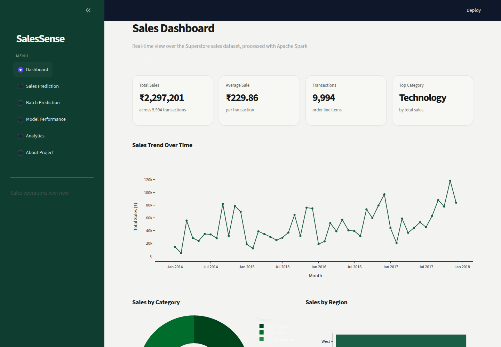
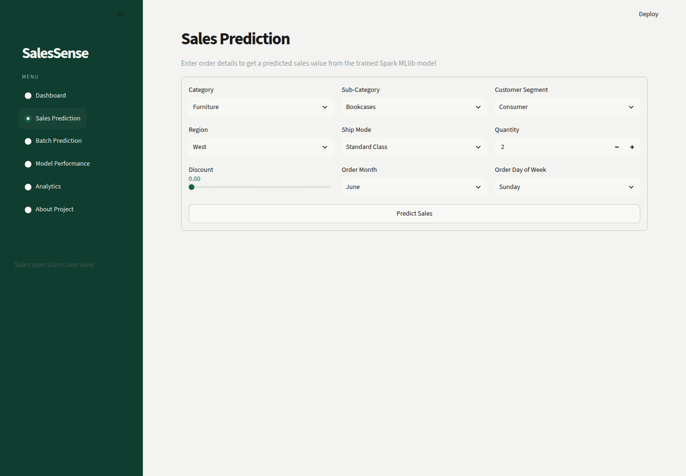
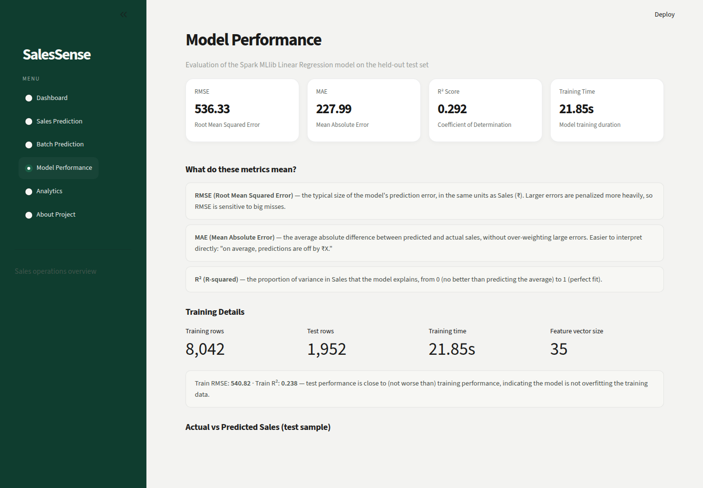
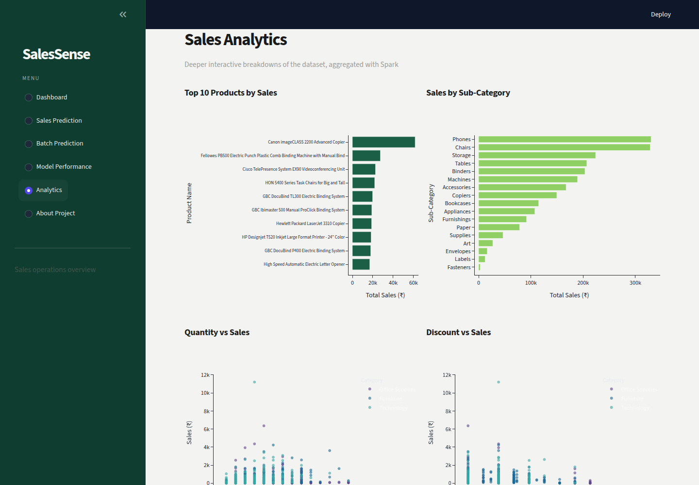

# 📊 SalesSense — Scalable Sales Prediction & Analytics System

SalesSense is a full-stack sales prediction and analytics application built with **Apache Spark
(PySpark + Spark MLlib)** for scalable data processing and machine learning, and **Streamlit +
Plotly** for an interactive, modern GUI. It was built as a college mini-project to demonstrate
genuine distributed-processing patterns rather than a notebook-style demo.



## Features

- **Dashboard** — KPIs (total sales, average sale, transaction count, top category), sales trend
  over time, category/region breakdowns, with date/category/region filters
- **Sales Prediction** — single-record prediction form with a styled result card
- **Batch Prediction** — upload a CSV of new records, get predictions for all of them, download
  the results
- **Model Performance** — RMSE / MAE / R², plain-language explanations of each metric,
  actual-vs-predicted scatter plot, residual distribution, train/test comparison
- **Analytics** — top products, sales by sub-category/region/segment/weekday, quantity-vs-sales
  and discount-vs-sales scatter plots
- **About Project** — problem statement, tech stack, why Spark, dataset summary, live model snapshot

## Tech Stack

| Layer | Technology |
|---|---|
| Distributed data processing | Apache Spark (PySpark), Spark SQL DataFrame API |
| Machine learning | Spark MLlib — `StringIndexer`, `OneHotEncoder`, `VectorAssembler`, `StandardScaler`, `LinearRegression`, `Pipeline` |
| Supporting libraries | Pandas, NumPy |
| Web application | Streamlit |
| Charts | Plotly |
| Language | Python 3.11 |

## Architecture

```
data/superstore.csv
        │
        ▼
 src/preprocessing.py     (Spark: load CSV, clean nulls/duplicates, cast types, parse dates)
        │
        ▼
 src/feature_engineering.py  (Spark: extract Month/Weekday, build ML Pipeline stages)
        │
        ▼
 src/train_model.py       (Spark MLlib: train/test split → fit Pipeline → LinearRegression
        │                   → evaluate RMSE/MAE/R² → save PipelineModel + metrics)
        ▼
 model/trained_model/     (saved Spark PipelineModel, reloaded by the app)
        │
        ▼
 app.py (Streamlit)       (Dashboard / Prediction / Batch Prediction / Model Performance /
                            Analytics / About — src/prediction.py & src/analytics.py do the
                            Spark work behind each page)
```

The same Spark code that runs here in local mode (`local[*]`, using all CPU cores on this
machine) would scale to a multi-node cluster without modification — only the `SparkSession`
master URL would change (see `src/spark_session.py`).

## Dataset

**Sample Superstore** — a well-known real-world US retail sales dataset. Source (Kaggle):
[`vivek468/superstore-dataset-final`](https://www.kaggle.com/datasets/vivek468/superstore-dataset-final).
A copy is already included at `data/superstore.csv` so the project runs immediately; to
re-download it yourself directly from Kaggle, see [Re-downloading the dataset from Kaggle](#re-downloading-the-dataset-from-kaggle) below.

- **9,994 rows × 21 columns**, 0 missing values, 0 duplicate rows (verified by inspection, not assumed)
- Order dates span **2014-01-03 to 2017-12-30** (4 years)
- Categorical fields: `Category` (3), `Sub-Category` (17), `Segment` (3), `Region` (4), `Ship Mode` (4)
- Target variable: **`Sales`** (continuous, ₹0.44 – ₹22,638.48, right-skewed)
- `Profit` is deliberately **excluded** from the model features — it is mathematically derived
  from Sales in this dataset, so including it would leak the target

## Installation

Requirements: Python 3.11 (or compatible), Java 11+ (required by Spark), pip.

```bash
git clone <this-repo-url>
cd SalesSense
pip install -r requirements.txt
```

> Note: `pip install pyspark` requires a working Java installation on your machine
> (`java -version` should succeed). If it's missing, install a JDK (e.g. OpenJDK 17/21)
> before installing requirements.

## Re-downloading the Dataset from Kaggle

The dataset is already included at `data/superstore.csv`, so this step is **optional**. If you
want to fetch it fresh directly from Kaggle instead:

```bash
pip install kaggle
```

1. Create a free Kaggle account if you don't have one: https://www.kaggle.com
2. Go to **Settings → API → Create New Token** — this downloads `kaggle.json`
3. Place it at `~/.kaggle/kaggle.json` (Linux/Mac, then `chmod 600 ~/.kaggle/kaggle.json`) or
   `C:\Users\<You>\.kaggle\kaggle.json` (Windows)
4. Run:
   ```bash
   python -m src.download_dataset
   ```

This pulls directly from [`vivek468/superstore-dataset-final`](https://www.kaggle.com/datasets/vivek468/superstore-dataset-final)
on Kaggle and saves it to `data/superstore.csv`, overwriting the included copy.

## How to Run

### 1. Train the model (produces `model/trained_model/` and `model/metrics.json`)

```bash
python -m src.train_model
```

This loads and cleans the dataset with Spark, builds the feature pipeline, trains the Linear
Regression model, evaluates it on a held-out test set, and saves the trained pipeline + metrics.
A pre-trained model is already included in `model/trained_model/`, so this step is optional
unless you want to retrain.

### 2. Launch the app

```bash
streamlit run app.py
```

Then open the URL Streamlit prints (typically `http://localhost:8501`).

## Example Usage

**Single prediction:** go to *Sales Prediction*, choose Category = Furniture, Sub-Category =
Chairs, Segment = Consumer, Region = West, Ship Mode = Standard Class, Quantity = 3,
Discount = 0.1, Order Month = June, Day = Wednesday → click **Predict Sales**.

**Batch prediction:** go to *Batch Prediction*, download the CSV template, fill in rows with
columns `Category, Sub_Category, Segment, Region, Ship_Mode, Quantity, Discount, Order_Month,
Order_DayOfWeek`, upload it, click **Run Batch Prediction**, download the results.

## Screenshots

| Dashboard | Sales Prediction |
|---|---|
|  |  |

| Model Performance | Analytics |
|---|---|
|  |  |

## Results

Trained on 8,042 rows, evaluated on 1,952 held-out rows (80/20 split, seed=42):

| Metric | Value |
|---|---|
| RMSE | 536.33 |
| MAE | 227.99 |
| R² | 0.292 |

Test performance is close to (slightly better than) training performance (train RMSE 540.82,
train R² 0.238), indicating the model generalizes without overfitting. The R² is modest because
Linear Regression is a purely linear model applied to a right-skewed target with a handful of
very large orders; see the report's Limitations section for a full discussion.

## Future Scope

- Try tree-based Spark MLlib regressors (`RandomForestRegressor`, `GBTRegressor`) for
  non-linear relationships
- Add hyperparameter tuning via `CrossValidator` / `ParamGridBuilder`
- Log-transform the skewed target to reduce the influence of extreme orders
- Deploy on an actual multi-node Spark cluster with a larger dataset
- Add user authentication and persistent prediction history

## Project Structure

```
SalesSense/
├── app.py                    # Streamlit application entry point
├── requirements.txt
├── README.md
├── .gitignore
├── data/superstore.csv
├── src/
│   ├── config.py              # paths, constants, feature lists
│   ├── spark_session.py       # shared SparkSession factory
│   ├── preprocessing.py       # Spark data loading & cleaning
│   ├── feature_engineering.py # date features + Spark ML pipeline stages
│   ├── train_model.py         # full training + evaluation script
│   ├── prediction.py          # single & batch prediction helpers
│   └── analytics.py           # Spark aggregations for the dashboard
├── model/
│   ├── trained_model/         # saved Spark PipelineModel
│   ├── metrics.json
│   └── test_predictions_sample.csv
├── assets/screenshots/
├── report/
└── presentation/
```
